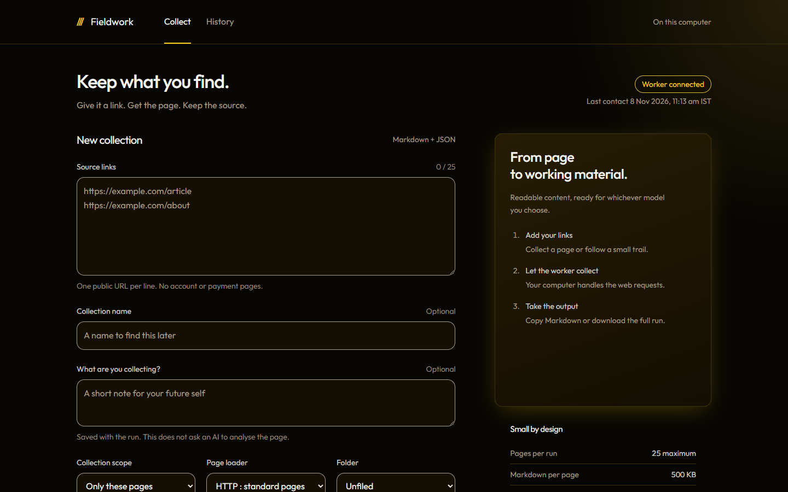
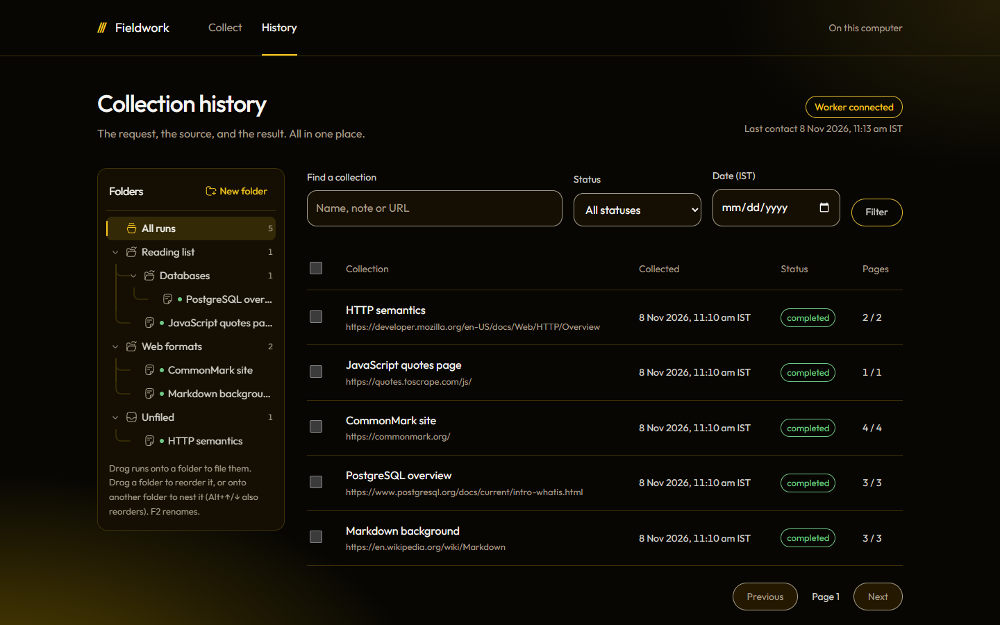
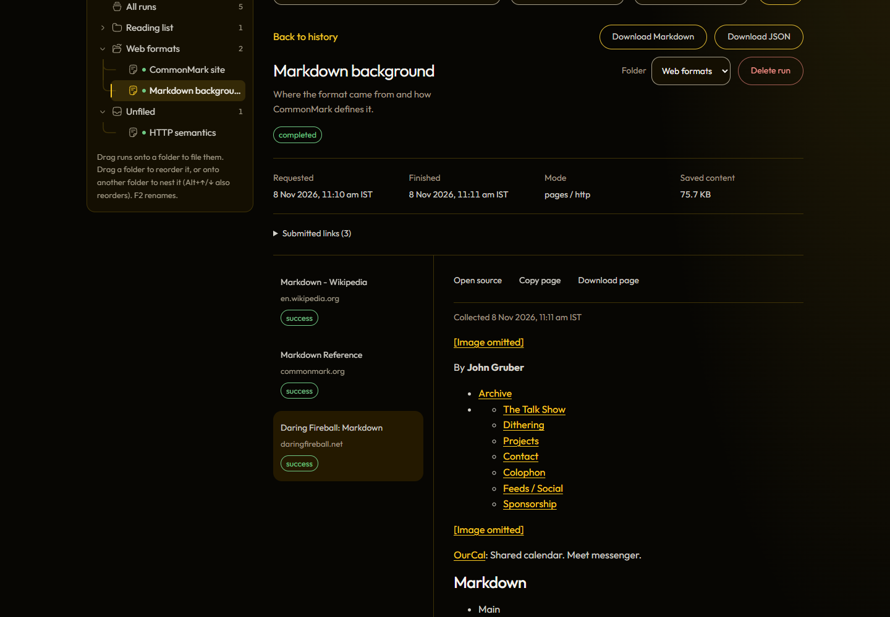
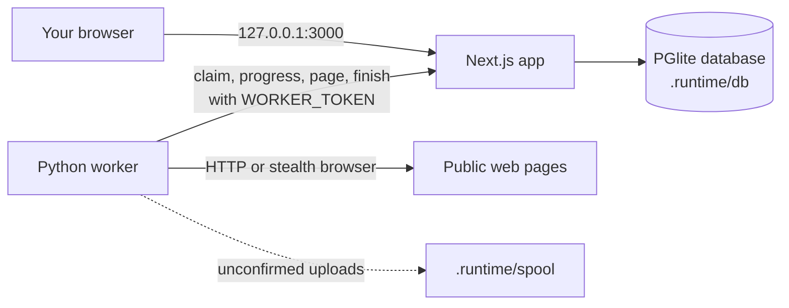

<p align="center">
  
</p>

<h1 align="center">Fieldwork</h1>

<p align="center">
  <b>Save web pages as clean Markdown on your own computer, filed in folders with dated history.</b>
</p>

<p align="center">
  <a href="#quick-start">Quick Start</a> |
  <a href="#screenshots">Screenshots</a> |
  <a href="#how-it-works">How It Works</a> |
  <a href="#security-and-privacy">Privacy</a>
</p>

<p align="center">
  <a href="https://github.com/priyanshu-programs/Fieldwork-scraper/actions/workflows/checks.yml"></a>
  
  
  
  
  
  <a href="LICENSE"></a>
</p>

---

## Overview

Paste a batch of links, or one site to follow. Fieldwork saves each page as Markdown with its source address and the time it was collected, including pages that need JavaScript or sit behind bot protection such as Cloudflare. File the runs in nested folders, then copy or download them for an AI model, a notes app or anything else that reads Markdown.

Everything runs locally: the app, the database and the collector. There are no accounts, no hosting, no AI API and nothing to pay for.

The repository is called `Fieldwork-scraper`; the app itself is Fieldwork.

## The Problem

Copying pages by hand loses the source and the date, and browser bookmarks don't keep the text. Fieldwork keeps all three. Each run records the addresses you asked for, every page attempt, any errors and UTC timestamps. Retrying creates a new run linked to the old one, so earlier results stay as they were.

## Features

| Feature | What it does | How |
|---|---|---|
| **Batch collection** | Saves up to 25 pages per run as Markdown | Scrapling `FetcherSession` with a Chrome network fingerprint |
| **Site crawl** | Follows links from one starting page, same host, two levels deep, up to 25 pages | Breadth-first queue in the Python worker |
| **Browser mode** | Handles pages that need JavaScript or show a Cloudflare challenge | Scrapling `StealthySession` (stealth Chromium) |
| **Folders** | Nested folders, drag-and-drop filing and reordering, keyboard control | Folder tree stored in the same local database as your runs |
| **History** | Search by name, note or URL; filter by status and date | Paged queries over embedded PostgreSQL |
| **Safe reader** | Read saved pages without running their scripts | `react-markdown` with raw HTML, images and unsafe links switched off |
| **Export** | Copy a page or a whole run, or download Markdown or JSON | Streaming export in the format `research-crawler/v1` |
| **Restore** | Brings a run back from its JSON export | Validated restore script that never overwrites existing runs |

## Screenshots

| Collect | History |
|---|---|
|  |  |

| Reading a saved run |
|---|
|  |

The screenshots show a separate test database filled with public pages collected for this README.

## How It Works



**The app.** A Next.js app serves the interface and a private API on `127.0.0.1`. It stores runs, pages and folders in [PGlite](https://pglite.dev), an embedded PostgreSQL that lives in a folder on disk. Migrations run automatically on start.

**The worker.** A separate Python process checks the app for queued runs. It claims one run at a time under a lease, fetches each page with [Scrapling](https://github.com/D4Vinci/Scrapling), converts it to Markdown and uploads it. Heartbeats keep the lease alive and tell the app the worker is connected. If the worker stops mid-run, the lease expires and the run is marked interrupted, ready to retry.

**The spool.** If the app can't be reached when a page is ready, the worker writes it to `.runtime/spool` and sends it later. Uploads the app refuses for good move to `.runtime/spool/rejected` so they never block the queue.

## Tech Stack

| Layer | Technologies |
|---|---|
| Interface | Next.js 16, React 19, TypeScript, Hugeicons, react-markdown |
| Database | PGlite 0.5 (embedded PostgreSQL), SQL migrations with checksums |
| Validation | Zod 4 on every API input |
| Collector | Python 3.12, Scrapling 0.5.1 (FetcherSession, StealthySession), httpx |
| Testing | Vitest, Playwright, Python `unittest` |
| CI | GitHub Actions: change log, secret scan, typecheck, tests, build, worker tests |

## Project Structure

```
Fieldwork-scraper/
├── src/
│   ├── app/              pages and the private API route
│   ├── components/       workspace, folder tree, collector animation
│   └── lib/              database, service, validation, security, export
├── worker/               Python collector, job loop, spool, tests
├── migrations/           SQL migrations, applied automatically on start
├── scripts/              setup, start, worker launcher, restore, commit checks
├── tests/                unit and route tests against real PGlite
├── browser-tests/        Playwright tests
├── docs/                 logo and screenshots
└── .github/workflows/    CI
```

## Quick Start

**Requirements:** [Node.js](https://nodejs.org) 22 or newer, [Python](https://www.python.org/downloads/) 3.12 (3.10 or newer works) and Git, on Windows, macOS or Linux. You don't need to download Scrapling separately; setup installs it.

```sh
git clone https://github.com/priyanshu-programs/Fieldwork-scraper.git
cd Fieldwork-scraper
npm ci
npm run setup
npm run app
```

`npm run setup` asks no questions. It generates a secret token for the worker, writes `.env.local` and `worker/.env.local` (Git ignores both), creates a Python virtual environment in `.venv`, and installs Scrapling and the browsers it needs. You can run it again at any time; it keeps the values you already have.

`npm run app` builds the app, then runs it together with the worker. The first build takes about a minute. When you see `Fieldwork is running`, open <http://127.0.0.1:3000>. The page shows **Worker connected** within about 30 seconds. Press Ctrl+C in the same window to stop both.

> [!WARNING]
> `npm run dev` is only for working on Fieldwork's code. The Next.js development server has internal endpoints that do not check which website a request comes from, so do not leave it running while you browse.

<details>
<summary><b>Manual setup</b></summary>

Copy `.env.example` to `.env.local` and `worker/.env.example` to `worker/.env.local`. Put the same random `WORKER_TOKEN` (at least 32 characters) in both. Then install the worker:

```sh
python -m venv .venv
# On Windows use .venv\Scripts\python.exe instead of .venv/bin/python
.venv/bin/python -m pip install -r worker/requirements.lock.txt
.venv/bin/python -c "from scrapling.cli import install; install([], standalone_mode=False)"
```

To run the parts in two windows instead of one: `npm run build` once, then `npm start` and `npm run worker`.

</details>

### Settings

| File | Key | Purpose |
|---|---|---|
| `.env.local` | `WORKER_TOKEN` | Shared secret the worker uses to talk to the app |
| `.env.local` | `LOCAL_DATABASE_DIR` | Optional. Database folder, default `.runtime/db` |
| `worker/.env.local` | `APP_URL` | Where the app runs, default `http://127.0.0.1:3000` |
| `worker/.env.local` | `WORKER_TOKEN` | Same value as the app's |
| `worker/.env.local` | `SPOOL_DIR` | Optional. Spool folder, default `.runtime/spool` |
| `worker/.env.local` | `CHROME_PATH` | Optional. Use an installed Chrome for browser mode |

## Using Fieldwork

**Collect.** Paste up to 25 public `http` or `https` addresses, one per line, or choose **Follow links on this site** with one starting address. Choose **Browser** for pages that need JavaScript or sit behind bot protection. Pick a **Folder** if you want the run filed straight away. The description field is a note for you and is not sent anywhere.

**Organise.** Folders can be nested as deep as you like. Drag runs onto a folder or onto **Unfiled**; dragging a ticked row moves every ticked run. Drag a folder between two others to reorder it, or onto a folder to put it inside. Arrow keys move through the tree, F2 renames and Delete deletes. Deleting a folder never deletes runs: its runs and subfolders move up one level.

**Read and export.** Open a run to see each page and its status. Copy one page or the whole run, or download Markdown or JSON. Times are shown in India Standard Time and stored in UTC.

**Delete.** Tick runs to **Move to** a folder or **Delete selected**. Deleting removes the run and its pages for good after you confirm. A run that is still collecting can't be deleted.

## Your Data

| What | Where |
|---|---|
| History | `.runtime/db`, created and updated automatically on start |
| Pages waiting to upload | `.runtime/spool`, sent again once the app is reachable |
| Uploads whose lease expired | `.runtime/spool/expired`, kept for manual recovery |
| Uploads the app refused for good | `.runtime/spool/rejected` |

Nothing in the spool folders is deleted automatically. Run one copy of the app per project folder, because the database allows only one app process at a time.

**Back up** by stopping the app and copying `.runtime/db`, or by downloading a run's JSON. **Restore** a run from its JSON with the app stopped (start it once first so the database exists):

```sh
npm run backup:restore -- "backups/run-backup.json" --confirm
```

The restore checks the file against the app's limits and never overwrites a run that already exists. Restored runs appear in **Unfiled**. Backups contain your research, so keep them out of Git.

## Security and Privacy

- The app listens on `127.0.0.1` only, so other devices on your network can't reach it.
- The private API refuses requests addressed to any other host name, which blocks websites that point their own domain at your computer to reach it.
- It also refuses changes sent from other websites.
- The worker authenticates with its own random token.
- There is no sign-in. Anyone using your computer while you are logged in can open the app, as with any other local app.

## Testing and CI

```sh
npm run typecheck
npm test                       # unit and route tests on real PGlite
.venv/bin/python -m unittest discover -s worker/tests -v
npm run test:browser           # set CHROME_PATH to use an installed Chrome
npm run build
npm run check:secrets
```

Browser tests start their own development server on port 3100 with a separate database, so they never touch your history.

GitHub Actions runs on every push and pull request: the secret scan, typecheck, unit tests, production build, and the worker tests on a clean Python install.

## Design Decisions and Limitations

- **Local only.** No hosting and no login keeps your research on your machine and costs nothing. The trade-off is that it runs on one computer.
- **Whole pages, not just the article.** Fieldwork saves the full page, so site menus and footers come along with the text.
- **Tables show as plain text in the reader.** The saved Markdown keeps them; the in-app reader doesn't draw them as tables yet.
- **HTML only.** PDFs and other file types are not collected.
- **No `robots.txt` check.** Fieldwork uses Scrapling's defaults, which don't read it. Redirects to private network addresses are rejected.
- **Limits.** 25 pages per run, 500 KB of Markdown per page, 10 MB per run.

## Responsible Use

**You are responsible for what you collect.** Getting past bot protection may break some sites' terms of service. Respect each site's terms, copyright and the laws where you live.

## Contributing

Issues and pull requests are welcome. Run `npm run hooks:install` once so the secret scan runs before each commit, and run the checks under [Testing and CI](#testing-and-ci) before opening a pull request. Interface changes should follow the rules in [design.md](design.md).

Report bugs and ask questions in [GitHub issues](https://github.com/priyanshu-programs/Fieldwork-scraper/issues).

## Thanks

Built on [Scrapling](https://github.com/D4Vinci/Scrapling), [PGlite](https://pglite.dev), [Next.js](https://nextjs.org) and [React](https://react.dev).

## License

[MIT](LICENSE) © 2026 Priyanshu Roy

## Author

**Priyanshu Roy**
GitHub: [@priyanshu-programs](https://github.com/priyanshu-programs)
